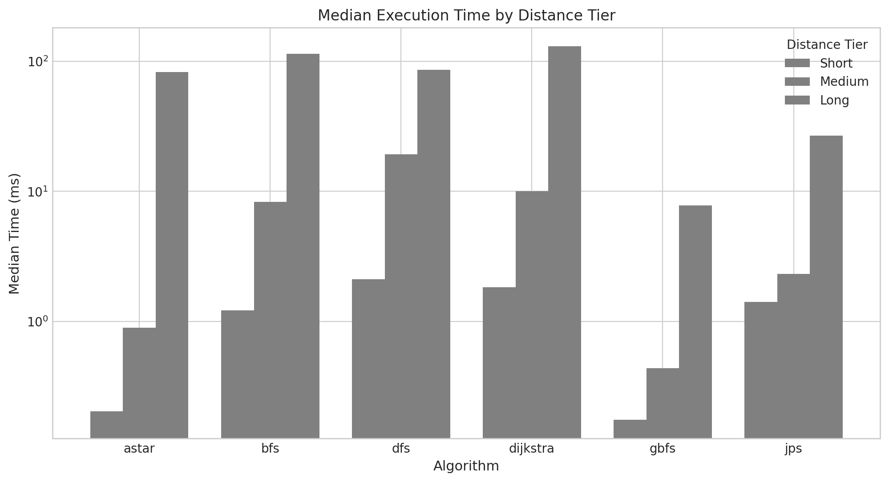
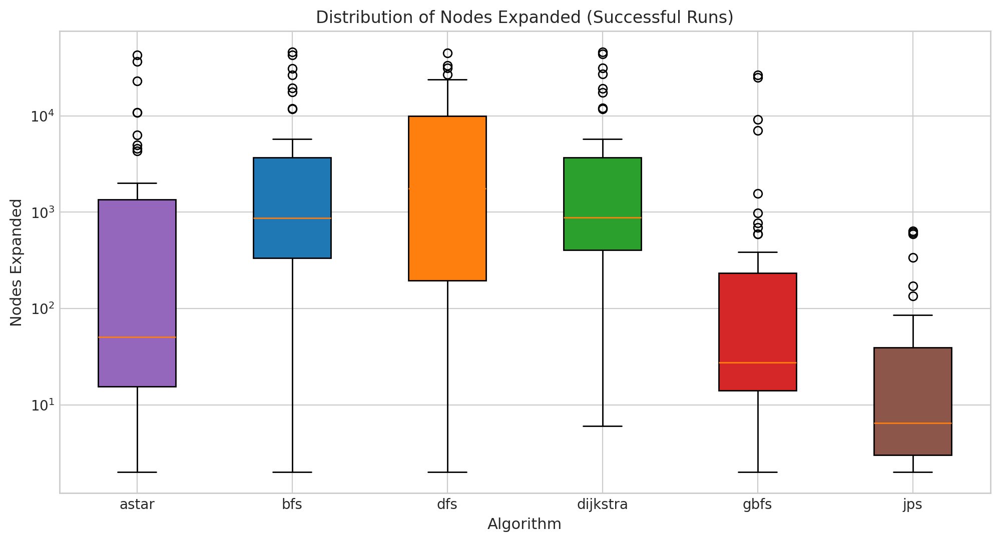
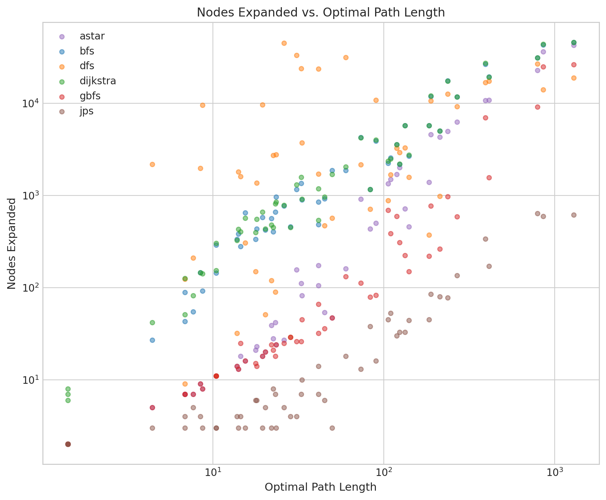
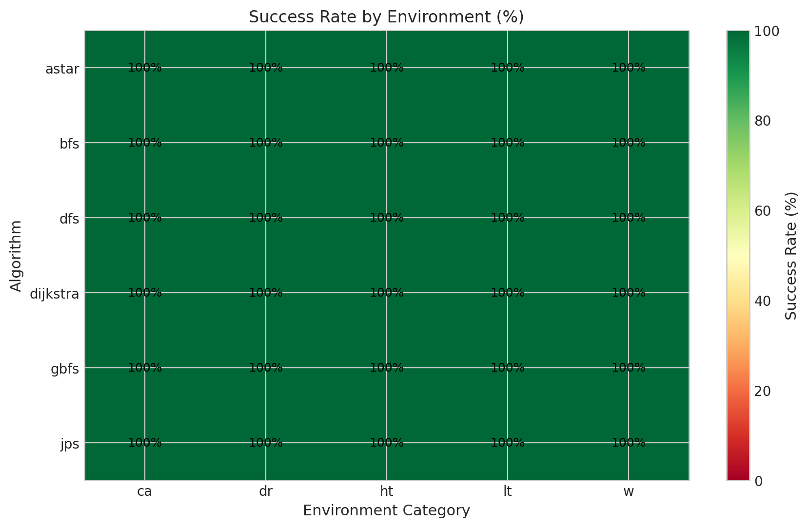
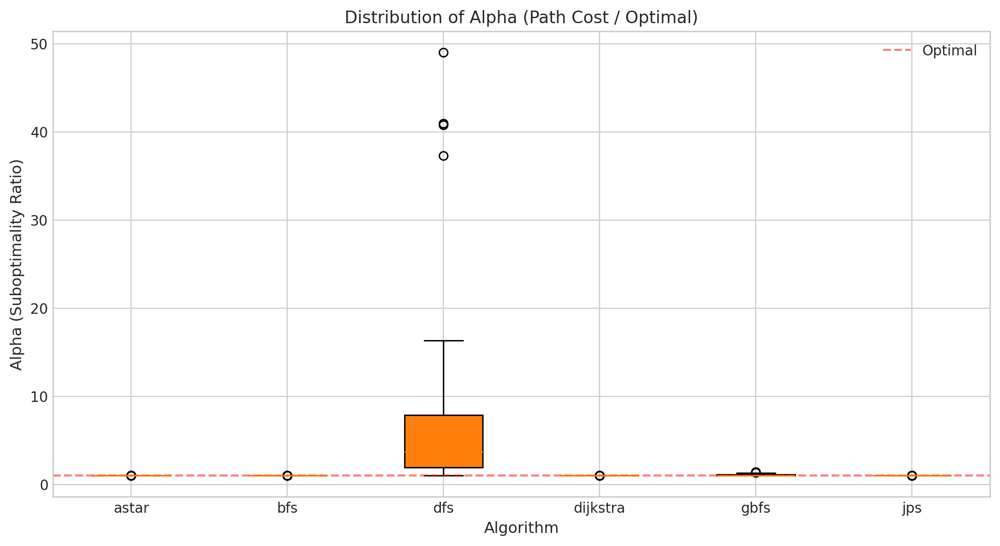
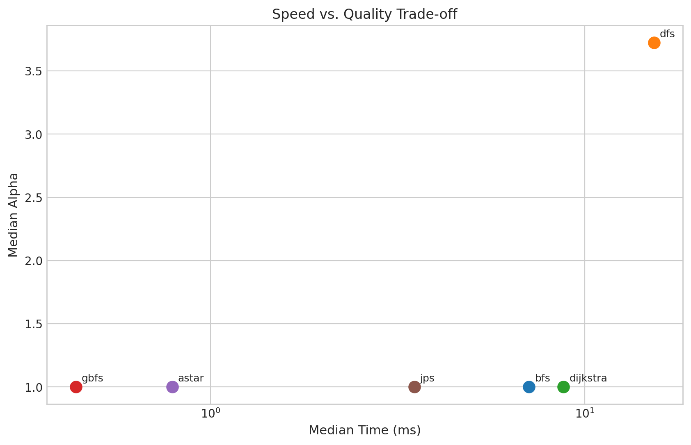
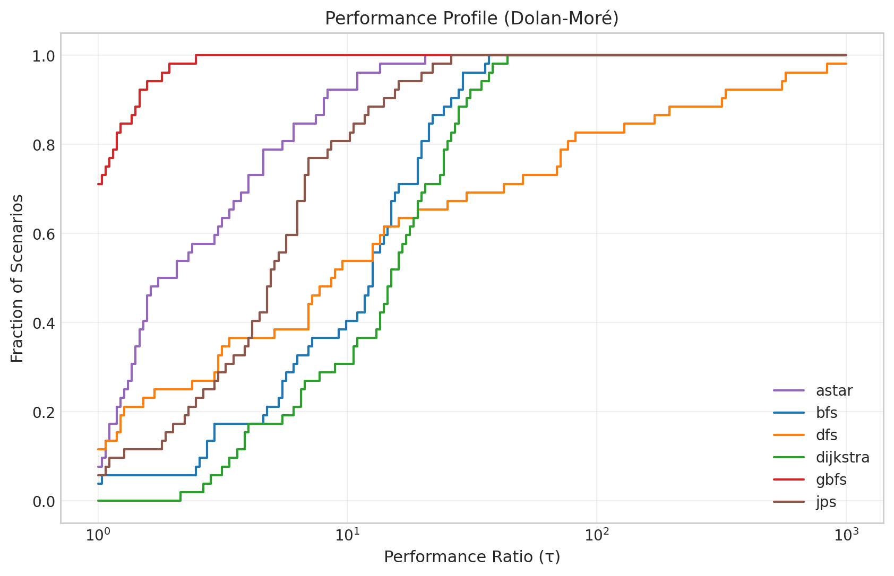

# Pathfinding Benchmark Report

**Run ID:** 2026-11-10_fast
**Date:** 2026-11-10_fast
**Seed:** 42
**Samples per tier:** 2
**Algorithms:** bfs, dfs, dijkstra, gbfs, astar, jps
**Maps:** 9 maps
**Timeout:** 5.0s
**Max nodes:** 100000

---

## Tables

### T1: Overall Performance


### T2: Performance by Distance Tier


### T3: Performance by Environment


### T4: Performance by Map Size


### T5: Failure Breakdown


---

## Figures

### F1: Median Time by Distance Tier



*Median execution time (ms) grouped by distance tier. Log scale.*

### F2: Nodes Expanded Distribution



*Boxplot of nodes expanded (successful runs only). Log scale.*

### F3: Nodes Expanded vs. Optimal Length



*Scatter plot showing growth rate of node expansions with path length. Log-log scale.*

### F4: Success Rate by Environment



*Heatmap of success rate (%) across environment categories.*

### F5: Alpha Distribution



*Boxplot of alpha (suboptimality ratio = path_cost / optimal). Red line at 1.0 indicates optimal.*

### F6: Speed vs. Quality Trade-off



*Scatter plot of median time vs. median alpha. Lower-left corner is ideal (fast and optimal).*

### F7: Performance Profile



*Dolan-Moré performance profile. Higher curves indicate more robust performance across scenarios.*

---

## Configuration

```json
{'run_id': '2026-11-10_fast', 'seed': 42, 'k': 2, 'maps': ['ht_store.map', 'lt_foundry_n.map', 'ht_playershouse_n.map', 'ca_cave.map', 'ht_keep.map', 'w_encounter1.map', 'lt_0_lowtown.map', 'w_woundedcoast.map', 'dr_0_deeproads.map'], 'algorithms': ['bfs', 'dfs', 'dijkstra', 'gbfs', 'astar', 'jps'], 'repeats': 3, 'timeout_s': 5.0, 'max_nodes': 100000, 'python': '3.10.12 (main, Aug 31 2026, 10:18:17) [GCC 11.4.0]', 'platform': 'linux', 'git_commit': '1fb3e2551ef91a4dd97638b5f9945bf8d2a748bb'}
```
