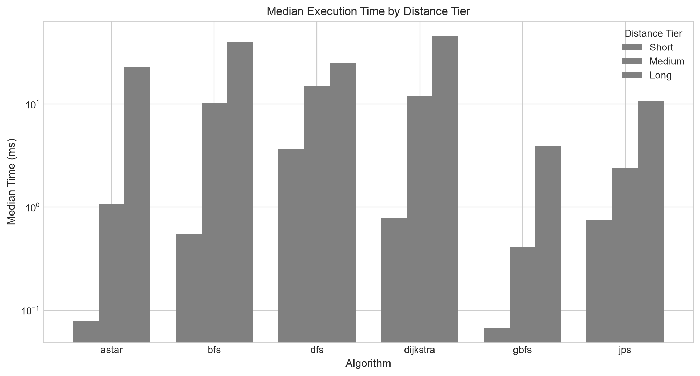
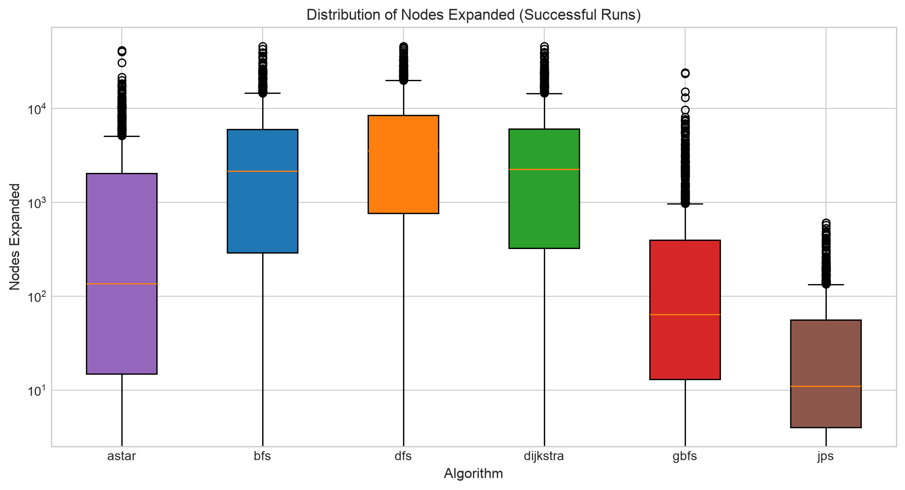
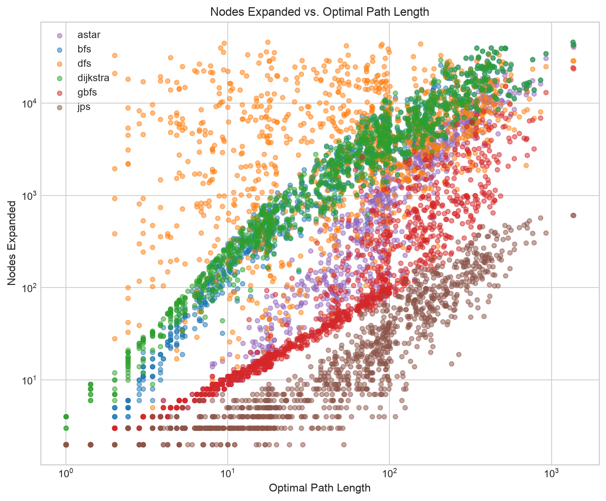
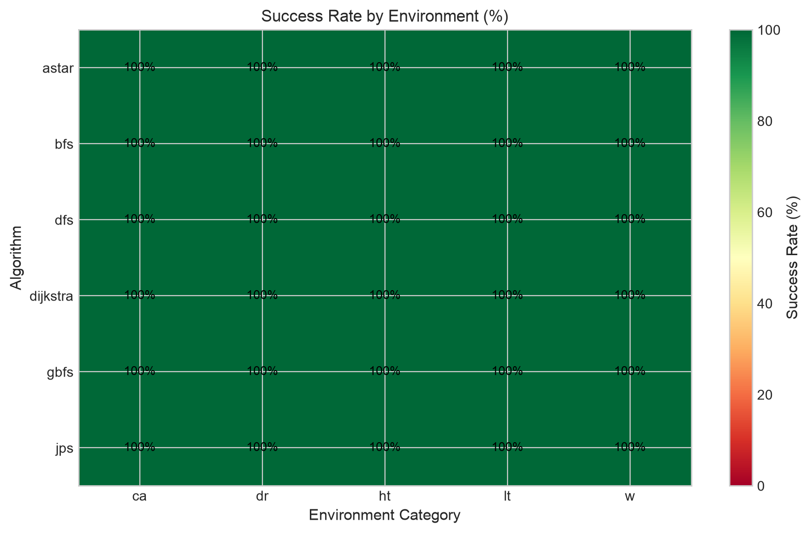
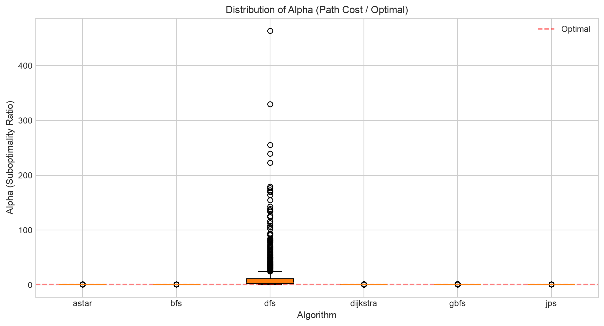
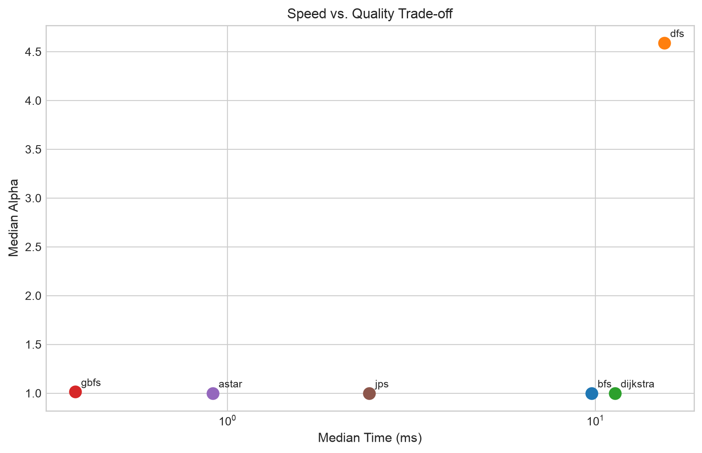
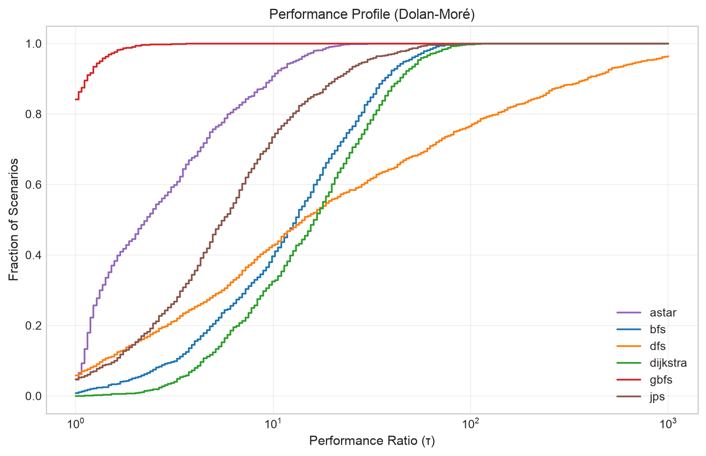

# Pathfinding Benchmark Report

**Run ID:** all_maps_run
**Date:** all_maps_run
**Seed:** 42
**Samples per tier:** 5
**Algorithms:** bfs, dfs, dijkstra, gbfs, astar, jps
**Maps:** 67 maps
**Timeout:** 5.0s
**Max nodes:** 100000

---

## Tables

### T1: Overall Performance


### T2: Performance by Distance Tier


### T3: Performance by Environment


### T4: Performance by Map Size


### T5: Failure Breakdown


---

## Figures

### F1: Median Time by Distance Tier



*Median execution time (ms) grouped by distance tier. Log scale.*

### F2: Nodes Expanded Distribution



*Boxplot of nodes expanded (successful runs only). Log scale.*

### F3: Nodes Expanded vs. Optimal Length



*Scatter plot showing growth rate of node expansions with path length. Log-log scale.*

### F4: Success Rate by Environment



*Heatmap of success rate (%) across environment categories.*

### F5: Alpha Distribution



*Boxplot of alpha (suboptimality ratio = path_cost / optimal). Red line at 1.0 indicates optimal.*

### F6: Speed vs. Quality Trade-off



*Scatter plot of median time vs. median alpha. Lower-left corner is ideal (fast and optimal).*

### F7: Performance Profile



*Dolan-Moré performance profile. Higher curves indicate more robust performance across scenarios.*

---

## Configuration

```json
{'run_id': 'all_maps_run', 'seed': 42, 'k': 5, 'maps': ['ca_cave.map', 'ca_cavern1_haunted.map', 'ca_caverns1.map', 'ca_caverns1_mines.map', 'ca_caverns2.map', 'ca_caverns2prc.map', 'dr_0_deeproads.map', 'dr_dungeon.map', 'dr_primevalentrance.map', 'dr_primevaltomb.map', 'dr_slavers.map', 'ht_0_hightown.map', 'ht_0_hightown_a2.map', 'ht_0_hightown_a3.map', 'ht_0_hightown_n.map', 'ht_bartrand_n.map', 'ht_brothel_n.map', 'ht_chantry.map', 'ht_chantry_n.map', 'ht_keep.map', 'ht_keep_n.map', 'ht_mansion2.map', 'ht_mansion2b.map', 'ht_mansion_n.map', 'ht_playershouse_n.map', 'ht_store.map', 'lt_0_lowtown.map', 'lt_0_lowtown_a2.map', 'lt_0_lowtown_a2_n.map', 'lt_0_lowtown_a2_n_c.map', 'lt_0_lowtown_a3_n_c.map', 'lt_0_lowtown_docks.map', 'lt_0_lowtown_docks_a3.map', 'lt_0_lowtown_docks_a3_n.map', 'lt_0_lowtown_docks_n.map', 'lt_0_lowtown_n.map', 'lt_backalley_g.map', 'lt_backalley_n.map', 'lt_darktown.map', 'lt_foundry_n.map', 'lt_gallowscourtyard.map', 'lt_gallowscourtyard_n.map', 'lt_gallowsprison_n.map', 'lt_gallowstemplar.map', 'lt_gallowstemplar_f.map', 'lt_gallowstemplar_n.map', 'lt_gamlenshouse_n.map', 'lt_hangedman.map', 'lt_hangedman_n.map', 'lt_house.map', 'lt_ruinedhouse_n.map', 'lt_shop.map', 'lt_undercitydungeon.map', 'lt_undercityencounter.map', 'lt_undercityserialkiller.map', 'lt_warehouse.map', 'lt_warehouse_n.map', 'w_blightlands.map', 'w_bonepit.map', 'w_bonepitdestroyed_a3.map', 'w_bonepitmining_a2.map', 'w_encounter1.map', 'w_encounter2.map', 'w_encounter2_camp.map', 'w_encounter3.map', 'w_sundermount.map', 'w_woundedcoast.map'], 'algorithms': ['bfs', 'dfs', 'dijkstra', 'gbfs', 'astar', 'jps'], 'repeats': 3, 'timeout_s': 5.0, 'max_nodes': 100000, 'python': '3.14.7 (v3.14.7:823f0323ee6, Aug  5 2026, 07:07:01) [Clang 21.0.0 (clang-2100.1.1.101)]', 'platform': 'darwin', 'git_commit': 'c87572a9887f53f5fd9084bffb9cb223114de818'}
```
